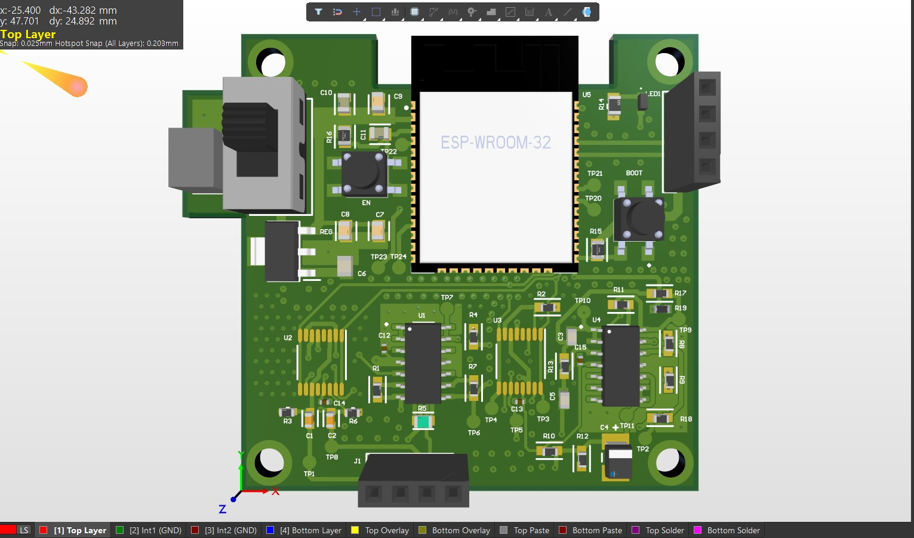
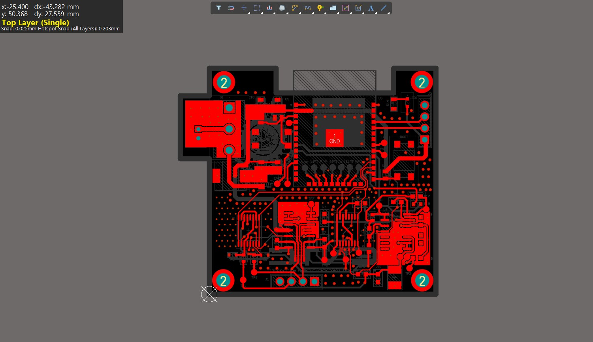
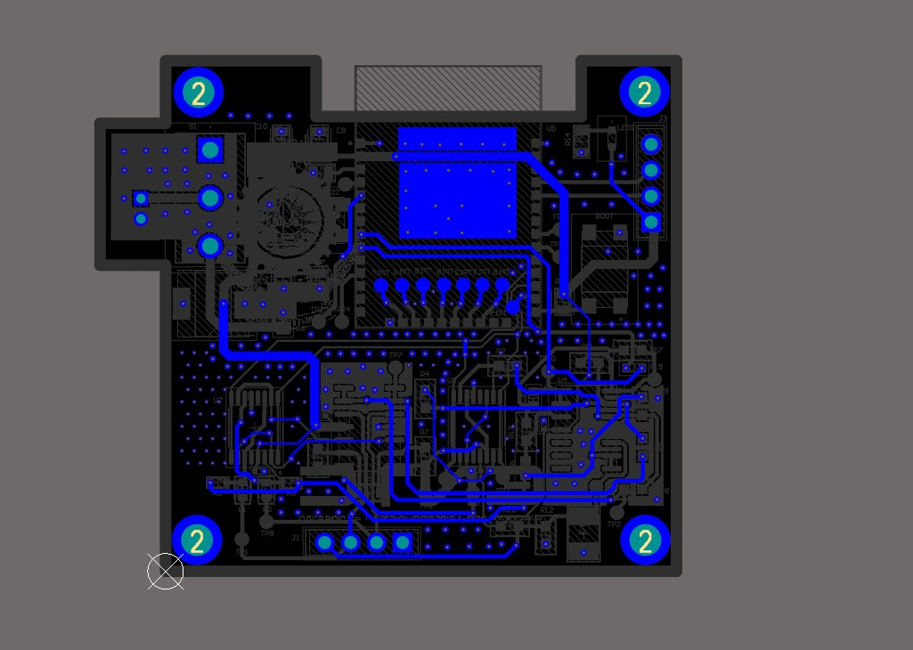
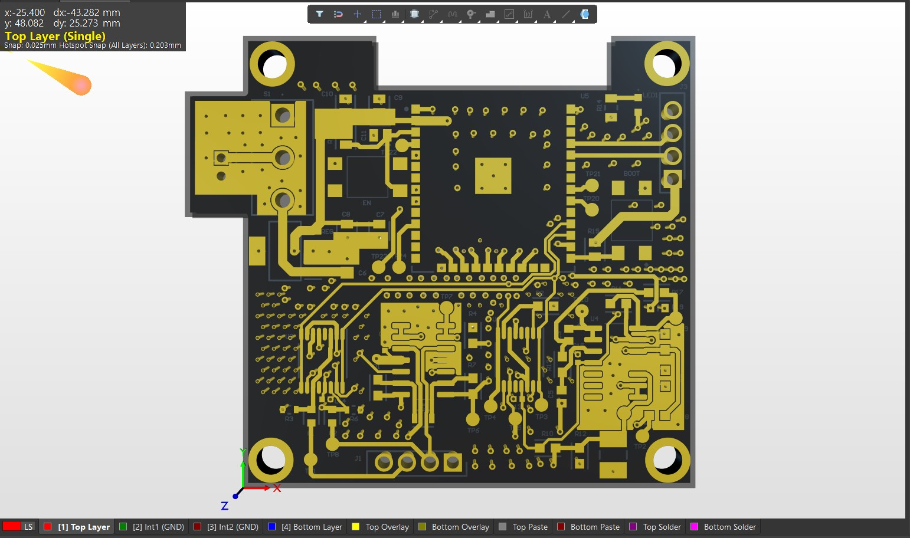

# Chopper-Stabilized Instrumentation Amplifier

A mixed-signal PCB design exploring chopper-based analog amplification using an ESP32-WROOM-32, TMUX1111 analog switches, and TLV9064 operational amplifiers.

## Hardware Components

- **ESP32-WROOM-32** — Chopper clock generation
- **2 × TMUX1111PWR** — Analog switching
- **2 × TLV9064IDR** — Operational amplification

## 3D Render & Layout Overview

| 3D Top View (Assembled) | 3D Top View (Bare PCB) |
| :---: | :---: |
|  |  |

## PCB Design & Layer Views

- **Four-layer PCB Structure**
- **Two internal ground planes (L2 and L3)**
- **Ground via stitching for improved grounding**
- **Local supply decoupling & signal isolation**

### Routing & Copper Fills

| Top Layer Routing (Red) | Bottom Layer Routing (Blue) |
| :---: | :---: |
|  |  |

| Copper Footprints | Ground Via Stitching  |
| :---: | :---: |
|  |  |

## Design Considerations

- Single-supply 3.3 V operation
- Clock feedthrough and switching noise
- Ground-plane continuity and return-current paths
- Analog signal integrity and power-supply decoupling

## Project Status

PCB design and development are in progress. Circuit performance and noise reduction will be evaluated through hardware testing.

## References

- [TMUX1111 — Texas Instruments](https://www.ti.com/product/TMUX1111)
- [TLV9064 — Texas Instruments](https://www.ti.com/product/TLV9064)
- [ESP32-WROOM-32 — Espressif Systems](https://documentation.espressif.com/esp32-wroom-32_datasheet_en.html)
